<div align="center">

# RuaTrip（Rua途）

**给无法养真宠物的人，一只可以用 3D 真实感形象云养、能真心聊天、能一起旅行打卡、还能自动帮你做手账的毛绒搭子。**

[](LICENSE)
[](#测试)
[](.nvmrc)
[](https://github.com/Guo-beep112241/ruatrip_pet_on_cloud/actions/workflows/ci.yml)

[功能](#功能) · [截图](#截图) · [快速开始](#快速开始) · [接入真实 API](#接入真实-api) · [架构](#技术栈与架构) · [文档](#文档索引)

</div>

---

<p align="center">
  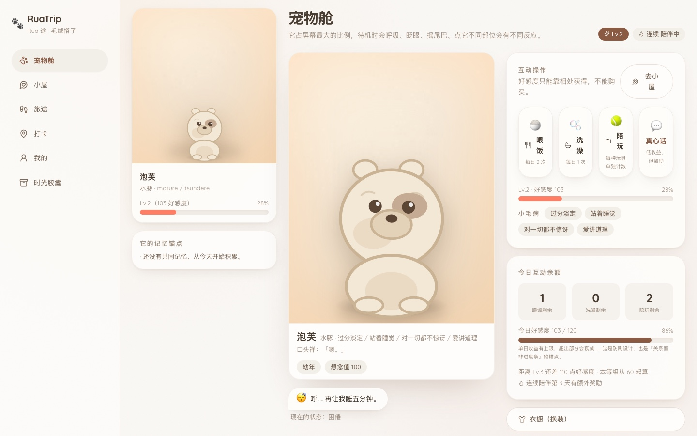
  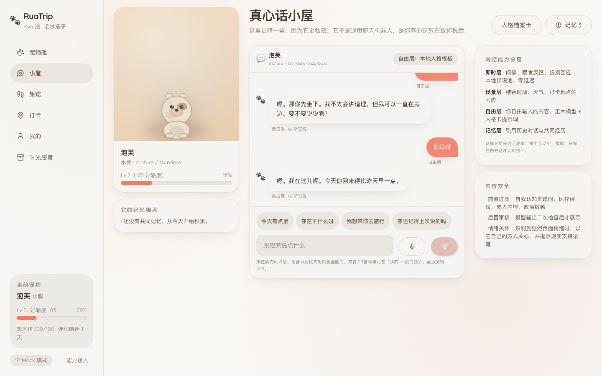
</p>

**开箱即用，不需要任何 API key。** 所有 AI / 3D / 语音 / 存储能力都是可插拔的：未配置时自动回落到本地 Mock 实现，网站功能完整、不白屏、不卡死，并在界面上如实标注降级状态。想接真实能力时只改 `.env`，不动代码。

本仓库是《[RuaTrip 产品详细说明书 v2.0](docs/RuaTrip产品详细说明书-v2.0.md)》的完整可运行实现。**电脑端与移动端同一份代码，响应式适配。**

---

## 功能

**宠物舱（首页）**
沉浸式展示区，待机时呼吸、眨眼、摇尾。点不同部位有不同反应（头 / 下巴 / 尾巴），长按是亲密互动、双击是撒娇。四项日常操作（喂饭 / 洗澡 / 陪玩 / 真心话）各自有次数与冷却。

**真心话小屋**
四层对话架构 —— 即时层（本地预设池，零延迟）· 场景层（结合时间、天气、打卡地点）· 自由层（走大模型 + 人格卡提示词）· 记忆层（引用历史对话与共同经历）。这样分层是为了省成本：常用互动不上模型，只有自由对话才调接口。

**旅途与手账**
宠物心愿单、城市剧情副本进度、旅途手账时间轴、明信片工坊。打卡后自动生成手账正文与宠物视角的明信片文案。

**打卡探索**
打卡地图、定位、实景照片上传、宠物出镜合成、徽章墙、城市限定皮肤、旅行盲盒，以及**旅行时光机**（再次到访同一地点时给出「上次来隔了 N 天」的对比回忆）。

**时光胶囊**
旧照上传 → 毛绒复原进度 → 纪念相册。针对已逝宠物，**不做推荐位**（只在安静的次级入口），并保留明确的预期管理文案「不是它本人」。

**账号与多用户**
邮箱密码注册登录、无状态会话、逐资源的归属校验。越权访问统一返回 404（不泄漏资源是否存在），注销账号需密码 + 手打 `DELETE` 并清空全部关联数据。

**关怀与安全**
高强度使用检测（停留过久 / 连续高频操作 / 连续提及离世话题）会以宠物口吻轻量提示休息，悲伤信号附现实支持渠道。同一信号一天只提示一次——关怀做成唠叨比不做更糟。

### 产品层面被刻意实现的设计

| 设计 | 原因 |
| --- | --- |
| **首日必须交付完整体验** | 问卷提交后立刻生成宠物 + 自动发放心愿单，不出现空状态 |
| **好感度是双向的** | 引入「想念值」，久不登录会下降，回来有重逢补偿与专属动画 |
| **好感度不可购买** | 商店只扣好感度，商品结构里没有任何现实货币字段。这是产品价值观的锚点 |
| **好感度不单向上涨** | 单日收益上限 120，超出部分衰减并单独记录（`cappedGain`） |
| **宠物性格必须有缺点** | 每只宠物生成 3~4 个小毛病（起床闹脾气、怕水、爱讲道理……），系统提示词里明确要求保留 |
| **任何真实通道失败都回落 Mock** | 页面不白屏、不卡死，只在日志与「能力接入」面板标注降级 |
| **密钥只在服务端** | 前端只访问 `/api`，任何第三方 key 都不进入前端产物 |

---

## 截图

移动端（390×844）与电脑端（1440×900）各一套，全部来自本仓库的实际运行结果。完整 16 张见 [`docs/screenshots/`](docs/screenshots/)。

| 首次使用引导 | 偏好问卷 | 宠物舱 |
| --- | --- | --- |
| 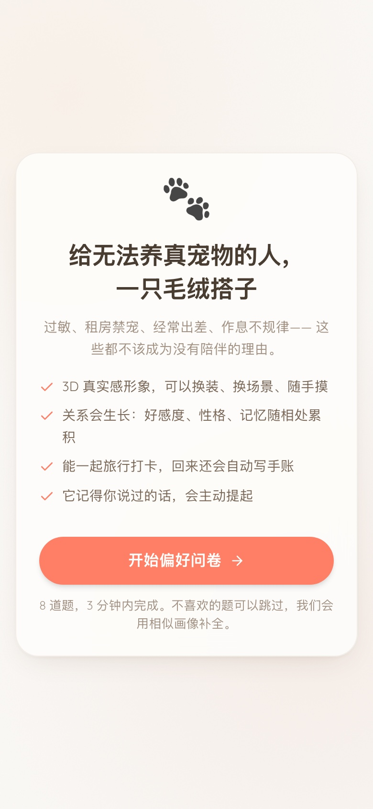 | 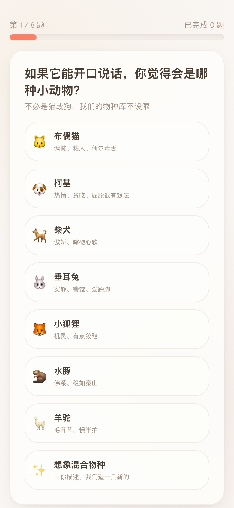 | 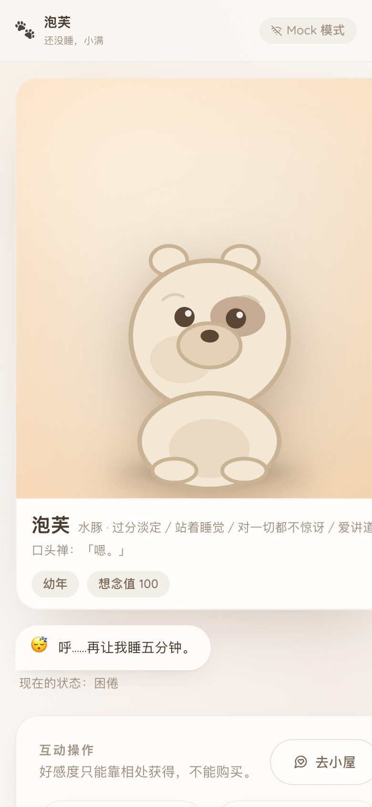 |

| 真心话小屋 | 旅途与手账 | 打卡探索 |
| --- | --- | --- |
| 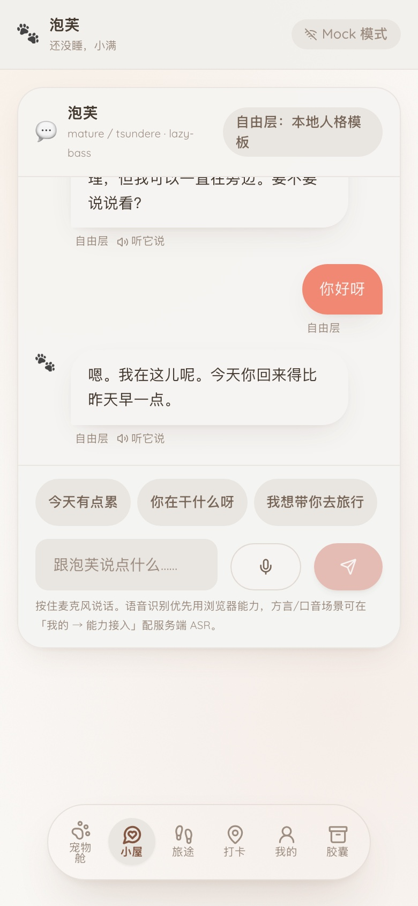 | 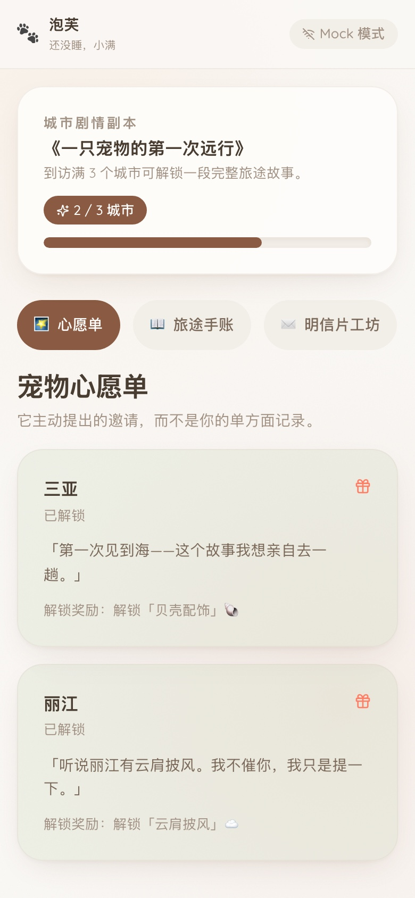 | 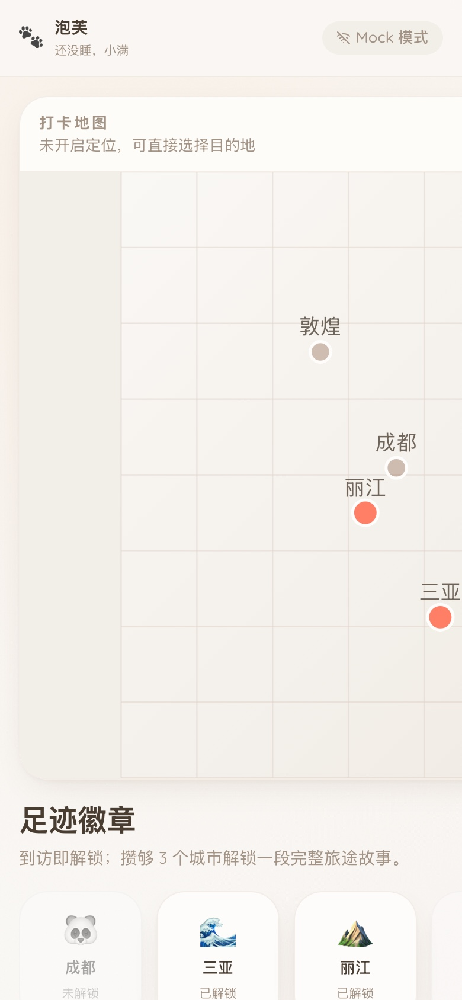 |

| 时光胶囊 | 我的 | 电脑端 · 打卡 |
| --- | --- | --- |
| 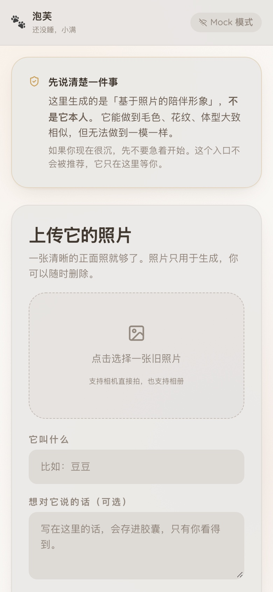 | 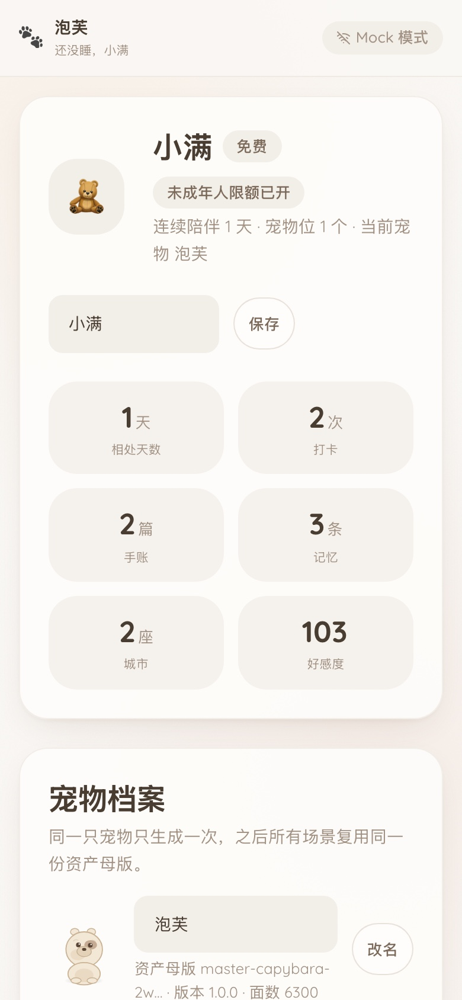 | 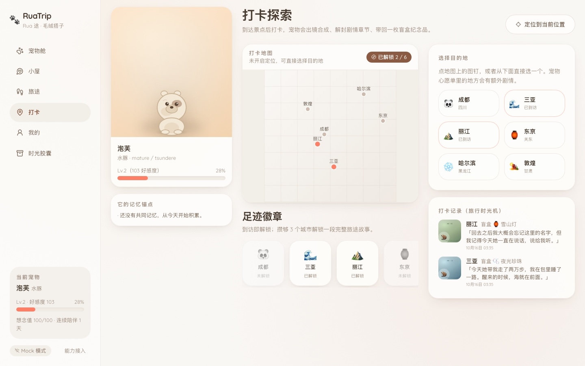 |

> 截图脚本是仓库的一部分，可以自己重新生成：
> `node scripts/screenshots.mjs --email <账号> --password <密码>`

---

## 快速开始

### 环境要求

- **Node.js ≥ 22.5**（`node:sqlite` 的下限，低于此版本会静默回落到 JSON 文件驱动）
- npm ≥ 10

### 安装与运行

```bash
git clone https://github.com/Guo-beep112241/ruatrip_pet_on_cloud.git
cd ruatrip_pet_on_cloud

npm install          # 安装 193 个依赖包
npm run dev          # 开发模式：后端 :8787 ＋ 前端 :5173（带热更新）
```

打开 <http://localhost:5173> → 走完 8 道问卷 → 看它孵化 → 进宠物舱。

**生产模式**（后端同源托管前端，只需要一个端口）：

```bash
npm run build        # 构建前端
npm start            # http://localhost:8787
```

> 桌面端把浏览器窗口拉到 ≥ 1024px 会切换成左侧栏 + 双栏布局；手机直接访问即可（Vite 已开 `host: true`）。

### 首次启动会要求注册账号

服务端默认 `AUTH_MODE=required`。第一个注册的账号就是你的账号，数据按账号隔离。

**生产环境必须配 `SESSION_SECRET`，否则服务端会拒绝启动**（用可预测密钥签名等于没有鉴权）：

```bash
node -e "console.log(require('crypto').randomBytes(32).toString('base64url'))"
```

### 可用命令

| 命令 | 说明 |
| --- | --- |
| `npm run dev` | 后端 + 前端并行开发（热更新） |
| `npm start` | 生产模式，同源托管前端 |
| `npm run build` | 构建前端到 `apps/web/dist` |
| `npm test` | 运行全部 213 个测试 |
| `npm run typecheck` | 全量类型检查（所有 workspace） |
| `npm run gen:theme` | 从设计令牌重新生成 CSS 变量与 Tailwind preset |
| `node scripts/backup.mjs` | 备份数据（SQLite checkpoint + 上传文件，支持轮转） |
| `node scripts/screenshots.mjs` | 用无头 Chrome 重新生成界面截图 |

---

## 接入真实 API

**默认状态：全部能力运行在 Mock 模式 —— 网站完整可用，但不产生真实 3D 资产、不调用真实大模型、不合成真实照片。**

启动后端后访问 `GET /api/integration`，或打开前端「**我的 → 能力接入**」面板，会列出每一项、依赖的环境变量，并支持一键复制模板。

```bash
cp .env.example .env    # 然后填 key
```

| # | 能力 | 环境变量 | 推荐 |
| --- | --- | --- | --- |
| 1 | 大模型对话 | `LLM_API_KEY` + `LLM_BASE_URL` + `LLM_MODEL` | **国产可用支付宝/微信付款**：DeepSeek / 智谱 / 通义 / Kimi / 硅基流动 |
| 2 | 3D 形象生成 | `TRIPO_API_KEY`（主力）/ `MESHY_API_KEY`（备份） | Tripo、Meshy |
| 3 | 自动绑定骨骼 | `ANYTHING_WORLD_API_KEY` | Anything World |
| 4 | 语音合成 | `MINIMAX_API_KEY` + `MINIMAX_GROUP_ID` / `ELEVENLABS_API_KEY` | MiniMax、ElevenLabs |
| 5 | 语音识别 | `ASR_API_KEY` + `ASR_BASE_URL` | 浏览器有兜底 |
| 6 | 图像合成 | `IMAGE_COMPOSER_API_KEY` + `IMAGE_COMPOSER_BASE_URL` | 本地 SVG 排版兜底 |
| 7 | 支付与订阅 | `PAYMENT_PROVIDER` + `PAYMENT_MERCHANT_ID` + `PAYMENT_API_KEY` | 见下文说明 |
| 8 | 对象存储 + CDN | `STORAGE_DRIVER` + `STORAGE_ENDPOINT` + `STORAGE_BUCKET` + `STORAGE_ACCESS_KEY` + `STORAGE_SECRET_KEY` + `CDN_BASE_URL` | S3 兼容：Cloudflare R2 / 腾讯云 COS / 阿里云 OSS / MinIO |
| 9 | 推送通知 | `PUSH_ENDPOINT` + `PUSH_VAPID_PUBLIC_KEY` + `PUSH_VAPID_PRIVATE_KEY` | 未配置时用应用内通知列表 |
| 10 | 行为埋点 | `ANALYTICS_ENDPOINT` + `ANALYTICS_WRITE_KEY` | 未配置时事件留在进程内可导出 |

**完整接入手册**（含请求示例、服务商对比、失败回落策略、验收清单）→ [docs/API-INTEGRATION.md](docs/API-INTEGRATION.md)

### 换模型只要改三行

```bash
# 例如换成 DeepSeek
LLM_API_KEY=sk-你的key
LLM_BASE_URL=https://api.deepseek.com
LLM_MODEL=deepseek-flash
```

智谱 `https://open.bigmodel.cn/api/paas/v4` + `glm-4-flash`、通义 `https://dashscope.aliyuncs.com/compatible-mode/v1` + `qwen-plus`、Kimi `https://api.moonshot.cn/v1` + `moonshot-v1-8k` 同理。改完 `.env` **不用重启**（配置是惰性读取的）。

### 关于支付

**订阅目前是「模拟开通」**：只写档位状态、不扣款，接口会如实返回 `simulated: true`。但**消费限额是真在生效的** —— 未成年人单笔 ¥50 上限、月限额硬封顶 ¥500、宠物位按档位配额（免费 1 / Plus 3 / Pro 6）、降级时若已有宠物超配额会被拒绝。接好支付通道后扣款交给支付服务，这套限额逻辑不用改。

### 数据持久化

三种驱动可选，默认 SQLite（Node 内置，零额外依赖）：

| 驱动 | 配置 | 适用 |
| --- | --- | --- |
| `sqlite`（默认） | `PERSISTENCE_DRIVER=sqlite` + `SQLITE_FILE` | 单机部署，**记得挂持久卷** |
| `postgres` | `PERSISTENCE_DRIVER=postgres` + `DATABASE_URL` + `npm i pg` | 多实例 / 托管数据库（Supabase、Neon 等） |
| `file` | `PERSISTENCE_DRIVER=file` | 本地开发、配置备份 |

> ⚠️ Render / Railway 等平台的免费档容器文件系统是**临时的**，重新部署会丢数据。要么挂持久磁盘，要么用 Postgres。

---

## 部署

已带 `Dockerfile`、`render.yaml` 与 `.dockerignore`。

**最快路径（全程在浏览器点，不需要本地任何配置）**：Render 控制台 → `New +` → `Blueprint` →
选本仓库 → `Apply`。`render.yaml` 会自动建好服务并生成 `SESSION_SECRET`，**不需要手填任何环境变量**；
几分钟后即可拿到 `https://<服务名>.onrender.com`，这个地址就能直接发给别人。
不配任何 AI key 也能跑：未配置的能力自动回落 Mock，并在前端「我的 → 能力接入」里如实标注降级。
免费档的两个限制（15 分钟无请求休眠、容器文件系统不持久）与数据保住的三种办法，见
[docs/DEPLOYMENT.md](docs/DEPLOYMENT.md)。

**国内访问的实测结论**（详细测量数据见 [docs/DEPLOYMENT.md](docs/DEPLOYMENT.md)）：`*.vercel.app` 在国内不可达（实测 3 个域名全部 TCP 连接超时），推荐两条路线：

- **A. 国内轻量服务器 + Docker**（推荐）—— 需要域名与 ICP 备案
- **B. Netlify / GitHub Pages 放前端 + Render 放后端** —— 需要配 `VITE_API_BASE_URL` 与 `CORS_ORIGIN`

```bash
docker build -t ruatrip .
docker run -p 8787:8787 \
  -e NODE_ENV=production \
  -e SESSION_SECRET="$(node -e 'console.log(require("crypto").randomBytes(32).toString("base64url"))')" \
  -e AUTH_MODE=required \
  -e CORS_ORIGIN=https://你的域名 \
  -v ruatrip-data:/app/.data \
  ruatrip
```

**上线前建议先过一遍 [docs/PRE-LAUNCH-AUDIT.md](docs/PRE-LAUNCH-AUDIT.md)**——27 项审计清单（安全、数据、账号、健壮性、产品、工程化）全部已完成，逐项附有验证证据。

---

## 技术栈与架构

**前端** React 18 + TypeScript(strict) + Vite 6 + Tailwind CSS 3 + zustand
**后端** Node 内置 `node:http` + `tsx` —— **零框架依赖**
**Monorepo** npm workspaces（`packages/shared` · `packages/theme` · `apps/server` · `apps/web`）

```
RUATRIP_BEST_PET_FRIENDS/
├── docs/                     产品说明书、视觉规范、接入手册、架构、部署、审计清单
├── packages/
│   ├── shared/               前后端共用：领域模型 + 静态目录 + 规则 + API 契约
│   └── theme/                设计令牌唯一来源 → 生成 CSS 变量 + Tailwind preset
├── apps/
│   ├── server/src/
│   │   ├── index.ts          只做 HTTP 处理、安全头、静态托管、启动与优雅退出
│   │   ├── appContext.ts     跨路由共享的实例与辅助函数
│   │   ├── routes/           12 个业务域路由 + 入参规则集中定义
│   │   ├── adapters/         换外部供应商只改这里（chat/mesh/rigging/tts/image/push/analytics）
│   │   ├── services/         业务规则（好感度、人格、对话编排、旅行、计费、关怀）
│   │   ├── repositories/     换数据库只改这里
│   │   ├── db/               SQLite / Postgres / JSON 三种驱动 + 增量落盘
│   │   ├── storage/          本地磁盘 / S3 兼容对象存储（自实现 SigV4）
│   │   └── http/             路由、校验、限流、错误映射、结构化日志、启动校验
│   └── web/src/              6 个页面 + 响应式外壳
└── scripts/                  备份、截图等运维脚本
```

**为什么后端不引框架**：静态资源也由后端同源托管，所以生产环境只需要一个端口、一个命令。整个 workspace 只有 193 个依赖包，`npm install` 很快就能完成 —— 第一阶段要验证的是「用户是否愿意每天回来」，不应该先被脚手架拖住。

**依赖方向是单向的**：`routes → appContext → adapters/services → db/storage`，没有环。

详细设计（数据流图、关键工程原则的落地位置、响应式策略、升级路径）→ [docs/ARCHITECTURE.md](docs/ARCHITECTURE.md)

---

## 测试

```bash
npm test        # 213 个测试，全部基于 node --test，不引测试框架
```

| 文件 | 数量 | 覆盖 |
| --- | --- | --- |
| `packages/shared/tests/rules.test.ts` | 10 | 好感度数值口径、等级曲线、想念值、情绪推导优先级 |
| `apps/server/tests/persona.test.ts` | 13 | 人格卡、跨物种风格差异、system prompt 完整性、四类内容安全、后置审核 |
| `apps/server/tests/llm-provider.test.ts` | 9 | **集成**：本地假模型端点验证请求格式、`reasoning_content` 隔离、错误翻译、失败回落 |
| `apps/server/tests/auth.test.ts` | 16 | scrypt 哈希、密码强度、会话签发校验、密码版本吊销、防枚举 |
| `apps/server/tests/isolation.test.ts` | 16 | **真实 HTTP**：越权读写全拒、伪造 token、改密码吊销、注销清数据 |
| `apps/server/tests/security.test.ts` | 18 | SVG 注入、CORS 白名单、敏感路径、安全头、限流与每日成本闸门 |
| `apps/server/tests/persistence.test.ts` | 16 | 三种驱动读写、增量 diff、原子写入、重启恢复、脏数据合并 |
| `apps/server/tests/storage.test.ts` | 21 | 图片魔数校验、体积上限、路径穿越防护、multipart 完整性、S3 适配 |
| `apps/server/tests/validate.test.ts` | 15 | 必填、类型、非对象体、长度、枚举白名单、未知字段丢弃 |
| `apps/server/tests/billing.test.ts` | 20 | 未成年人单笔/月上限与硬封顶、宠物位配额、降级保护、防绕过 |
| `apps/server/tests/care-analytics.test.ts` | 21 | 关怀的克制性、埋点隐私白名单、推送不假装投递 |
| `apps/server/tests/logger-errors.test.ts` | 18 | 日志脱敏（含嵌套与循环引用）、JSON Lines、错误码映射 |
| `apps/server/tests/integration-registry.test.ts` | 5 | 接入面板声明的变量必须真被代码读取、文档锚点必须存在 |
| `apps/server/tests/e2e.test.ts` | 15 | **端到端**：注册 → 问卷 → 孵化 → 互动 → 对话 → 打卡 → 手账 → 商店 → 订阅 → 注销 |

CI（`.github/workflows/ci.yml`）在 Node 22 与 24 上各跑一遍，并额外做一次**生产模式冒烟**：真起服务、请求接口、抽查安全头，抓「类型与测试都过但服务起不来」这类问题。

---

## API

所有接口都在 `/api` 下，响应统一为 `{ ok: true, data }` 或 `{ ok: false, error: { code, message, detail? } }`。

| 方法 | 路径 | 说明 |
| --- | --- | --- |
| GET | `/api/health` | 健康检查（真实探测持久化/存储/最近落盘，核心故障返回 503） |
| GET | `/api/integration` | **接入状态报告**（哪些是真实通道、哪些是 Mock） |
| GET | `/api/bootstrap` | 首屏聚合：用户 + 宠物 + 接入清单 + 场景 + 引导进度 |
| GET | `/api/catalog` | 物种 / 问卷 / 目的地 / 商店 / 订阅 / 场景 / 规则 |
| POST | `/api/auth/register` `/login` | 注册 / 登录 |
| GET | `/api/auth/status` `/me` | 初始化状态 / 当前账号 |
| POST/DELETE | `/api/auth/password` `/account` | 改密码 / 注销并删除全部数据 |
| GET/POST/PATCH | `/api/pet` | 查询 / 创建并开始孵化 / 改名换装换场景 |
| GET | `/api/pet/generation/:jobId` | 生成进度轮询 |
| GET | `/api/asset/pet.svg` | 本地降级宠物形象 |
| GET/POST | `/api/survey` | 问卷题目 / 提交并返回偏好画像 |
| POST | `/api/interact` `/api/interact/pet` | 日常互动 / 抚摸 |
| GET | `/api/affection` | 好感度总览、今日余额、连续陪伴进度 |
| GET/POST | `/api/shop` `/api/shop/redeem` | 好感度商店与兑换（**不可购买**） |
| GET/POST | `/api/chat` | 小屋历史 / 发送消息（四层对话 + 安全过滤） |
| GET | `/api/chat/memories` | 记忆回看与容量 |
| POST | `/api/tts` | 语音合成（未接入时返回浏览器兜底标记） |
| GET | `/api/travel` | 目的地 / 心愿单 / 打卡记录 / 徽章 / 手账 / 明信片 |
| POST | `/api/travel/checkin` | 打卡（合成图 + 剧情 + 盲盒 + 手账 + 明信片） |
| GET/POST | `/api/journal` `/api/postcard` | 手账与明信片 |
| GET/POST | `/api/capsule` | 时光胶囊项目与复原进度 |
| GET/POST | `/api/foster` | 云代养 |
| GET/PATCH | `/api/profile` | 成长数据 / 设置（含计费状态） |
| POST | `/api/subscribe` | 订阅（受消费限额约束） |
| GET/POST | `/api/notifications` | 应用内通知列表 / 想念值召回检查 |
| GET | `/api/analytics/summary` `/export` | 埋点汇总与导出（仅行为计数，不含对话内容） |
| POST | `/api/client-error` | 前端错误上报 |

---

## 已知限制

诚实地列出来，避免误导：

- **默认是 Mock 模式。** 开箱即用看到的宠物是本机生成的 SVG 形象，对话走人格模板而非大模型。这是刻意的设计（说明书要求「任何真实通道失败都回落 Mock」），不是未完成。
- **前端登录流程未在真实浏览器中做过完整回归。** 接口层、类型、构建都有验证，界面截图也是实测产出，但登录/注销的交互路径建议自己手动走一遍。
- **架构取舍**：持久化是「内存快照 + 增量落盘」，单进程假设。约 200KB/用户，到千级用户量级没问题；上万用户或需要多实例时，要重写 `repositories/` 的读写路径（当前所有读写都从这里走，改动面是收敛的）。
- **对象存储默认是本地磁盘。** 生产环境请配 S3 兼容存储，否则容器重建会丢图片。
- **未实现**：真实支付扣款、口型同步、联网双宠、真 AR、ICP 备案。相关接口与数据结构已按「接入后逻辑不变」预留。
- **字体从 Google Fonts 加载**，国内直连通常不可达，会回落到系统字体。想更贴近设计稿可以自托管字体文件。

---

## 贡献

欢迎提 Issue 与 PR。开始之前：

1. 读 [AGENTS.md](AGENTS.md) —— 本仓库的约束与不可破坏的不变量
2. 需求以 [产品说明书](docs/RuaTrip产品详细说明书-v2.0.md) 为唯一事实来源，视觉以 [视觉设计规范](docs/视觉设计规范-毛绒实木.md) 为唯一事实来源
3. 改颜色请改 `packages/theme/src/tokens.ts` 后跑 `npm run gen:theme`，**不要手改**生成出来的 `apps/web/src/styles/tokens.css`
4. 提交前确保 `npm run typecheck && npm test && npm run build` 全绿

**代码风格**：TypeScript strict；服务端零框架、零额外运行时依赖（这是有意为之）；注释与 commit message 用中文，写清「做了什么 + 为什么」。

---

## 文档索引

| 文档 | 内容 |
| --- | --- |
| [产品详细说明书 v2.0](docs/RuaTrip产品详细说明书-v2.0.md) | 需求唯一事实来源 |
| [视觉设计规范 · 毛绒实木](docs/视觉设计规范-毛绒实木.md) | 视觉唯一事实来源 |
| [API 接入手册](docs/API-INTEGRATION.md) | **需要你介入 API 的全部位置**，含请求示例与验收清单 |
| [技术架构](docs/ARCHITECTURE.md) | 数据流、工程原则落地、响应式策略、升级路径 |
| [上线部署指南](docs/DEPLOYMENT.md) | **国内访问的实测方案**、备份、监控与日志 |
| [上线前审计清单](docs/PRE-LAUNCH-AUDIT.md) | 27 项审计（分级 + 逐项验证证据） |
| [信息架构](docs/confirmed-ia.json) · [线框图](docs/wireframe.jpg) | 设计阶段产物 |

---

## 许可证

[MIT](LICENSE) © 2026 Guo-beep112241

---

<div align="center">
<sub>如果这个项目对你有帮助，欢迎点一个 ⭐</sub>
</div>
